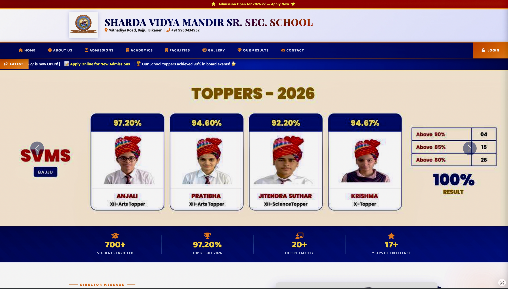
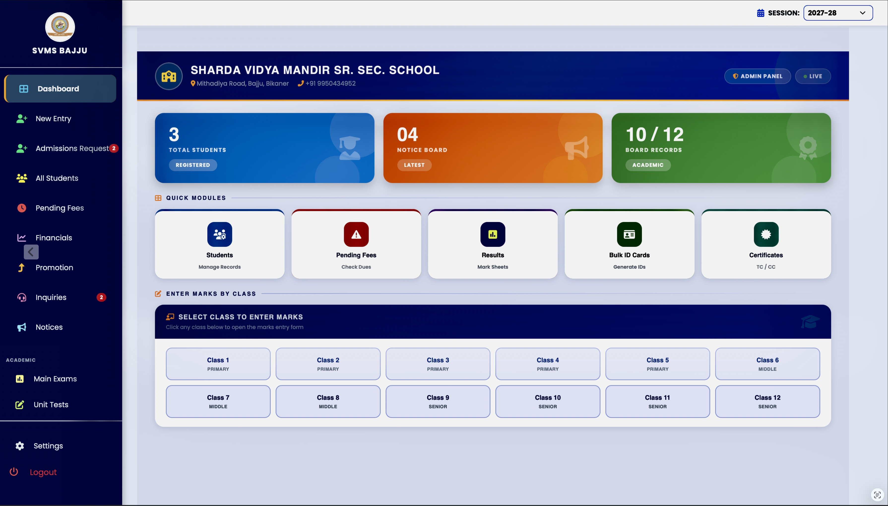
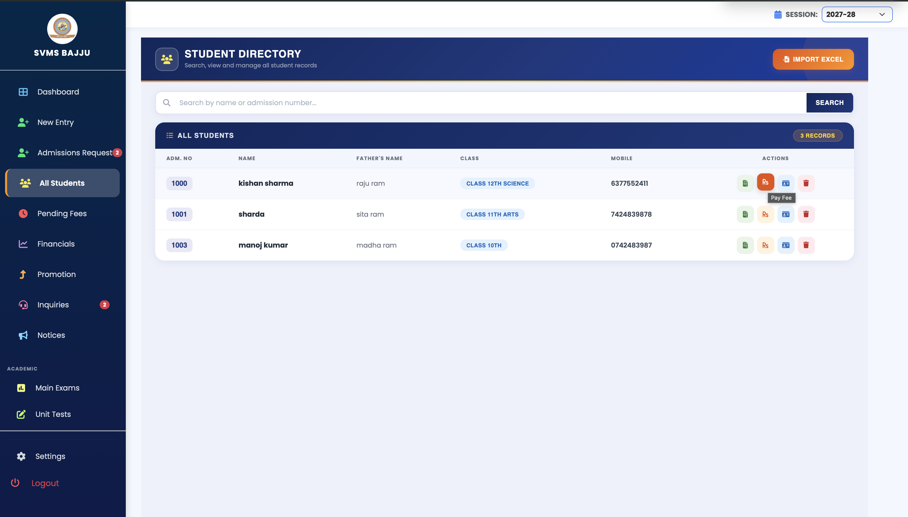
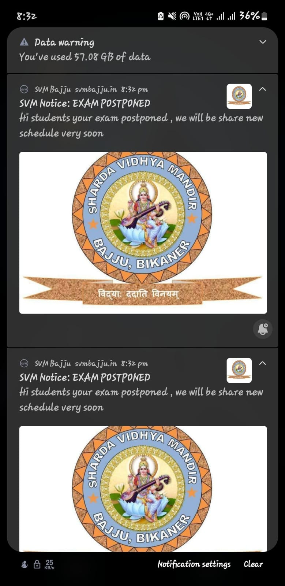

# 🏫 School ERP & Real-Time Notification System

A full-stack school management system built and deployed for a real school serving **700+ students** and **20+ faculty members**. The system handles student records, staff management, role-based access, and real-time notifications — all running in production.

**🔗 Live Demo:** [svmbajju.in](http://svmbajju.in)

---

## 📌 Problem Statement

The school was managing student records, staff data, and announcements manually using registers and spreadsheets. This led to:
- Data redundancy and errors
- No centralized access control
- Delayed communication with parents and staff
- No backup or recovery system

## 💡 Solution

Built and deployed an end-to-end ERP system that digitized the entire workflow — from student enrollment to real-time push notifications — with role-based access and automated backups.

---

## ✨ Features

### 🔐 Authentication & Access Control
- Role-based authentication (Admin, Staff, Student)
- Secure session management
- Protected routes and APIs

### 📊 Management Modules
- Student records (enrollment, classes, details)
- Staff/faculty management
- Structured data management with admin dashboards

### 🔔 Real-Time Notifications
- Web Push Notification system
- Instant alerts across mobile and desktop
- PWA support for app-like experience

### 🚀 Production Deployment
- Cloud hosting with custom domain
- DNS configuration
- SSL certification (HTTPS)
- Scheduled automated database backups

---

## 🛠️ Tech Stack

| Layer | Technology |
|-------|-----------|
| Frontend | HTML5, CSS3, JavaScript (PWA) |
| Backend | Python, REST APIs |
| Database | MySQL |
| Deployment | Cloud Hosting, DNS, SSL |
| Tools | Git, GitHub, Linux |

---

## 🏗️ System Architecture

* **Client:** PWA (Progressive Web App)
* **Backend:** REST API Layer (Python)
* **Services:**
  * Auth Service (Role-based)
  * Student/Staff Management
  * Notification Service (Web Push)
* **Database:** MySQL (with automated backups)

---

## 📸 Screenshots

| Homepage | Admin Dashboard |
|----------|----------------|
|  |  |

| Student Records | Notifications |
|-----------------|---------------|
|  |  |

---

## 🎯 Impact

- **700+ students** and **20+ faculty** using the system
- Eliminated manual record-keeping errors
- Instant communication via push notifications
- Automated backups ensure data safety

---

## 🔒 Note on Source Code

This repository contains documentation and screenshots of the production system. The source code is private due to client confidentiality. For a technical walkthrough or code samples, feel free to reach out.

---

## 👨‍💻 Author

**Manoj Kumar**
- GitHub: [@manojkumar1902](https://github.com/manojkumar1902)
- LinkedIn: [LinkedIn Profile](https://www.linkedin.com/in/𝑀𝐴𝑁𝑂𝐽-𝐾𝑈𝑀𝐴𝑅-58ba49234)
- Email: mkkumawat1902@gmail.com

---
⭐ If you found this project interesting, feel free to star the repo!
